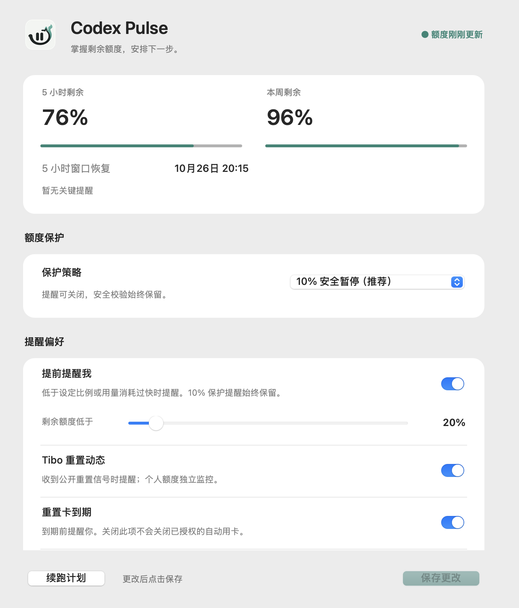

  
  

<h1 align="center">Codex Pulse</h1>

Codex 快没额度时，帮你留住进度；恢复后，安全接着做。

  <a href="https://github.com/CJaxonJ/codex-pulse/releases/download/v0.9.20/Codex-Pulse-0.9.20-macOS.zip"><strong>下载 macOS 版 · v0.9.20</strong></a> ·
  <a href="./开始使用.md">安装指南</a> ·
  <a href="./docs/releases/v0.9.20.md">更新记录</a>

## 能帮你做什么

- **少错过重置**：提醒 Tibo 的公开重置信号，区分预告、确认和个人额度到账。
- **别把额度用到断档**：提前预警；默认在 10% 保护线阻止后续工具操作，保存任务进度。
- **恢复后接着做**：核对原任务、文件和权限后续跑，也能先查看下一步计划。
- **少浪费重置卡**：临期提醒；可单独授权，在不足 10 分钟且有额度可重置时自动使用一张。

支持 macOS 上的个人 Plus / Pro 账户，按账户实际提供的额度窗口工作。

看一眼实际界面（演示数据）

直接截取自原生应用，图中额度仅用于演示，不是实时账户数据。

## 三步开始

1. **下载并解压**上面的 ZIP，双击 `安装 Codex Pulse.command`，不要下载源码包。
2. **允许通知并确认保护**：阅读安装后窗口的说明，点击「开启自动保护」。
3. **方便时重开 Codex**：保护对新会话生效。之后照常使用，从 `Codex Pulse.app` 查看额度和调整提醒。

需要已登录的 Codex、Node.js 20+ 和 Apple Command Line Tools；缺少依赖时按安装提示补齐。
普通使用不需要 API 绑卡、开发者身份验证或 X 凭证。遇到问题先看[完整安装指南](./开始使用.md)。

## 用之前知道这几件事

- **仍在 Beta**。10% 保护依赖 Codex Hook，不能撤销正在运行的工具，也不能保证精确停在 10%。
- **不会冒险重启任务**。文件或目标变了、需要审批、状态不明时，会提示你处理，而不是强行续跑。
- **提醒不保证必达**。睡眠、断网或公共数据源故障可能延迟或漏掉提醒；公开预告不代表个人额度已到账。
- **自动用卡默认关闭**，需单独授权。计划和额度记录保存在本机，不会上传给开发者，也不会替你批准其他权限。

这是独立项目，非 OpenAI 或 X 官方产品。当前请通过安装包使用，**尚未上架官方插件目录**。

---

[使用指南](./开始使用.md) · [问题反馈](https://github.com/CJaxonJ/codex-pulse/issues) · [技术与开发](./docs/technical-guide.md) · [隐私](./PRIVACY.md) · [安全](./SECURITY.md) · [MIT](./LICENSE)
