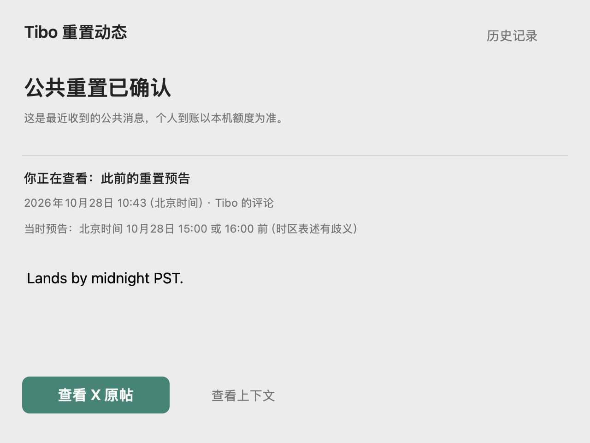

# Codex Pulse v0.9.21 · Beta

预告直接显示北京时间，关掉通知后也能找回原帖。本次没有新增权限，不更改已审查的 Hook、10% 保护、自动续跑或自动用卡策略。

## 改了什么

- 有明确时间窗口的 Tibo 预告换算为北京时间；相对时长从发帖时间计算，不会随刷新推迟。模糊表述保持“具体时间未定”。
- PST/PDT 与数据源换算冲突时说明歧义，不提供虚假精准倒计时。同一预告补充或修改时间会更新提醒；时间已过则提示尚未确认，不冒充个人到账。
- 通知增加“查看 X 原帖”，App 增加固定的“Tibo 动态”入口。英文原文、来源时间、原帖和已知父帖链接仅存本机；最近 10 条公共记录不会被普通额度提醒挤掉。
- 动态详情把最新收到的状态与所选历史消息分开。历史使用简短时间列表，原帖作为主按钮；旧记录缺少链接时明确提示，不跳到主页代替。
- 修复开发时隔离测试发现的历史列表越界崩溃，新增列表缩短、刷新、历史选择保持、长原文滚动及跳转失败检查。

## 验证与边界

- 264 项自动化回归，以及浅色、深色、小窗口、低额度、缺失／过期数据的原生设置与动态详情验证。
- 完整本地发布门禁覆盖隔离安装回滚、真实测试 launchd 服务、常驻提醒和离线暂停／恢复链路；另外检查实时 Tibo 数据源和安装包结构、校验和。
- 本次没有创建真实模型测试聊天、故意消耗额度或使用重置卡。原帖打开测试验证实际按钮路由与目标链接，不声称验证了每位用户的 X 登录、浏览器网络或系统通知必达。
- 公开预告不是 OpenAI 保证；公共确认也不代表每个账户已经到账。睡眠、断网和数据源故障仍可能造成延迟或遗漏。

## 安装

下载 `Codex-Pulse-0.9.21-macOS.zip`，解压后双击 `安装 Codex Pulse.command`。升级保留设置和记录；兼容的已审查插件不变，不需要因本次更新重新信任 Hook。

完整产品通过 macOS 安装包提供，尚未上架官方插件目录。
